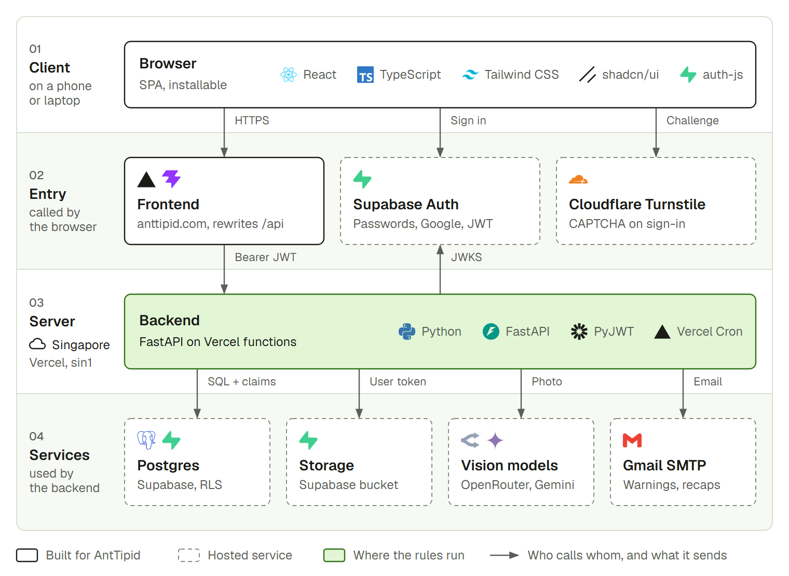

<p align="center">
  
</p>

<p align="center">
  <strong>A free expense and budget tracker for the Philippine peso that warns you before your money runs out.</strong>
</p>

<p align="center">
  <a href="https://anttipid.com">anttipid.com</a> ·
  <a href="#getting-started">Getting started</a> ·
  <a href="#api">API</a> ·
  <a href="docs/DSS.md">DSS roadmap</a>
</p>

<p align="center">
  
  
  
  
  
</p>

---

## Overview

AntTipid tracks spending and income across cash, e-wallets, bank accounts and credit cards, all in pesos. It is built as a
**decision support system**: transactions feed a set of rules, statistics and a K-means model, and the app turns their
output into plain-language warnings the user can act on, such as the date a budget will run out at the current pace, the
amount that is safe to spend each day, and purchases that are unusual for that user.

The app is a mobile-first, installable single-page app. Most people use it on a phone.

## Features

### Tracking

- **Wallets** for cash, e-wallets, banks and credit cards, each with a running balance
- **Transactions** for expenses, income and transfers, with categories, notes and line items
- **Receipt scanning**: take a photo and the form fills itself (merchant, date, total, items, suggested wallet) using free
  vision models on OpenRouter, with Gemini as the fallback. Limited to 30 scans per user per day.
- **Receipt photos** stored privately per user
- **Activity** view grouped by day, with search, filters, and CSV or PDF export

### Decision support

| Feature | Method | What the user sees |
|---|---|---|
| Budget limit rule | Rules | Category budgets cannot add up to more than the monthly budget |
| Outside-budget spending | Statistics | Spending in categories without a budget, flagged once it passes the unassigned room |
| Run-out date and safe daily amount | Statistics (pace) | The day a budget runs out at this month's pace, and how much to keep to each day to last the month |
| Saved vs budget | Rules (budget history) | How a finished month ended against the budgets it had at the time |
| Paid once a month | Rules | Bills like rent are set aside and left out of the pace |
| Anomaly detection | ML (K-means) | Unusual purchases are flagged; the user marks each as a one-off or normal |

Anomaly detection learns each user's spending habits per category from the last six months. It picks the number of
clusters by silhouette score, treats the largest clusters as habits (as in CBLOF), and flags a purchase whose modified
z-score against its nearest habit is above 3.5. On a sample user it scored precision 1.00, recall 0.71 and F1 0.83,
against 0.18 / 0.88 / 0.30 for a plain 3x-median rule. The user's decision on each flag feeds back into what counts as
normal. Details, thresholds and the evaluation are in [docs/DSS.md](docs/DSS.md) and
[backend/paper_anomalies.py](backend/paper_anomalies.py).

### Reports and notifications

- **Reports**: earned, spent and saved; spending by category; a six-month income vs spending trend; daily spending;
  printable monthly report as PDF
- **Notifications**: an in-app bell and optional email when a budget is near its limit, used up, over, or on pace to run
  out, and for unusual purchases, plus a monthly recap sent by a Vercel cron job on the 1st of each month

### Account and data

- Email and password or Google sign-in through Supabase Auth, with optional Cloudflare Turnstile CAPTCHA
- One active session per account, on one device and one tab at a time
- Audit log of every change, written by database triggers
- JSON backup and restore of a user's records
- Row-level security on every table, so each user can only read and write their own rows

## Screens

| Screen | What comes first |
|---|---|
| Home | Left to spend this month with a pace bar, then budgets and purchases needing attention, wallets, recent activity |
| Activity | All transactions for a month grouped by day; search, filters, export |
| Add (sheet) | Amount, category, save. Wallet and date are pre-filled. "Scan a receipt instead" fills it from a photo |
| Budgets | Monthly budget, category budgets worst first, quick-add for categories without a budget |
| Reports | Earned, spent and saved; spending by category; six-month trend as a chart or table |
| Settings | Wallets, categories, notifications, account, backup and restore, audit log |

## Architecture

<p align="center">
  
</p>

- The **frontend** is a static React build on Vercel. It rewrites `/api/*` to the backend, so the browser only ever
  talks to one origin.
- The **backend** is FastAPI running as Vercel functions in Singapore (`sin1`). Every user-data route verifies the
  caller's Supabase JWT (HS256 or ES256/RS256 via JWKS) and sets the JWT claims on the database transaction, so Postgres
  RLS (`user_id = auth.uid()`) applies on top of explicit `user_id` filters.
- **Supabase** provides Auth, Postgres (reached through the transaction pooler on port `6543`) and a private Storage
  bucket for receipt photos. Storage calls use the caller's own token, so the backend needs no service-role key.
- "Today" is the user's calendar day in `APP_TIMEZONE` (default `Asia/Manila`), not the server's UTC day.

### Tech stack

| Layer | Technologies |
|---|---|
| Frontend | React 19, TypeScript 6, Vite 8, React Router 7, Tailwind CSS 4, shadcn/ui on Base UI, Recharts, Sonner, jsPDF |
| Backend | Python 3, FastAPI, Uvicorn, psycopg 3 with a connection pool, PyJWT, httpx |
| Data | Supabase Postgres with RLS, Supabase Auth, Supabase Storage |
| Services | OpenRouter and Gemini (receipt reading), Gmail SMTP (email), Cloudflare Turnstile (CAPTCHA) |
| Hosting | Vercel (two projects, `sin1`), domain on Cloudflare |

## Repository layout

```
frontend/              React app
  src/pages/           One file per screen (home, activity, budgets, reports, settings, landing, ...)
  src/components/      App components; ui/ holds the shadcn/ui primitives
  src/lib/             Budget math, reports, formatting, PDF export, with *.test.ts next to each
  src/api/             Typed API client and endpoints
  public/              Icons, manifest, service worker, help diagrams
backend/               FastAPI app
  main.py              App setup, CORS, receipt scan route, router wiring
  ledger.py            Wallets, categories, transactions, receipt photos, CSV export
  reports.py           Budgets, reports, anomaly checks and decisions
  anomalies.py         K-means anomaly detection (pure Python)
  notify*.py           Notification rules, email, monthly recap cron
  audit.py, backup.py  Audit log, backup and restore
  test_*.py            Self-checks
supabase/migrations/   SQL schema: tables, RLS policies, triggers, Storage bucket
docs/                  DSS roadmap and K-means evaluation pages
```

## Getting started

### Prerequisites

- Node.js 22.18 or newer (the frontend tests run TypeScript directly with `node --test`)
- Python 3.11 or newer
- A Supabase project
- An OpenRouter or Gemini API key, for receipt scanning

### 1. Set up the database

The schema is a set of SQL migrations in `supabase/migrations/`. Apply every file in name order in the Supabase SQL
Editor, or with `psql`:

```bash
for f in supabase/migrations/*.sql; do psql "$DATABASE_URL" -f "$f"; done
```

The migrations create the tables with RLS enabled, a trigger that seeds 11 default categories for each new user, the
audit log triggers, and the private `receipts` Storage bucket (1 MB limit; WebP, JPEG and PNG only).

### 2. Configure environment variables

Copy the example files and fill them in:

```bash
cp backend/.env.example backend/.env
cp frontend/.env.example frontend/.env.local
```

**Backend** (`backend/.env`)

| Variable | Required | Description |
|---|---|---|
| `SUPABASE_URL` | Yes | Project URL, `https://<project-ref>.supabase.co` |
| `SUPABASE_ANON_KEY` | Yes | Anon or publishable key |
| `DATABASE_URL` | Yes | Transaction pooler connection string (port `6543`) |
| `SUPABASE_JWT_SECRET` | No | Legacy HS256 secret; not needed with asymmetric signing keys |
| `OPENROUTER_API_KEY` / `GEMINI_API_KEY` | One of them | Vision model keys for receipt scanning |
| `SMTP_USER` / `SMTP_APP_PASSWORD` | No | Gmail address and app password for email; without them the bell still works |
| `APP_URL` | For email | Frontend address, used in email links and as the allowed CORS origin |
| `CRON_SECRET` | On Vercel | Any long random string; Vercel sends it with cron requests |
| `APP_TIMEZONE` | No | Defaults to `Asia/Manila` |

**Frontend** (`frontend/.env.local`)

| Variable | Required | Description |
|---|---|---|
| `VITE_SUPABASE_URL` | Yes | Project URL |
| `VITE_SUPABASE_ANON_KEY` | Yes | Anon or publishable key |
| `VITE_TURNSTILE_SITE_KEY` | No | Cloudflare Turnstile site key; leave empty while CAPTCHA is off |
| `VITE_DEMO_EMAIL` / `VITE_DEMO_PASSWORD` | No | Demo login shown on the sign-in page; it is public, so use a password that is used nowhere else |
| `VITE_API_URL` | No | Defaults to `/api`, which the Vite dev server proxies to `http://localhost:8000` |

### 3. Run the app

```bash
# Terminal 1: backend on http://localhost:8000
cd backend
python -m venv .venv
.venv/Scripts/python -m pip install -r requirements.txt   # macOS/Linux: .venv/bin/python
.venv/Scripts/python -m uvicorn main:app --reload --port 8000
```

```bash
# Terminal 2: frontend on http://localhost:5173
cd frontend
npm install
npm run dev
```

### Optional: Google sign-in

1. In Google Cloud Console, go to **APIs & Services > Credentials** and create an OAuth client ID (Web application) with
   the redirect URI `https://<project-ref>.supabase.co/auth/v1/callback`.
2. In Supabase, go to **Authentication > Sign In / Providers > Google**, turn it on, and paste the client ID and secret.
3. In Supabase, go to **Authentication > URL Configuration > Redirect URLs** and add `http://localhost:5173/sign-in` and
   `https://<your-domain>/sign-in`.

### Optional: Cloudflare Turnstile

1. In Cloudflare, go to **Turnstile** and add a Managed widget for `localhost` and your deployed domain. Put its site key
   in `VITE_TURNSTILE_SITE_KEY`, both locally and on Vercel.
2. Deploy the frontend first. Then, in Supabase, go to **Authentication > Attack Protection**, turn on CAPTCHA
   protection with Turnstile, and paste the widget's secret key.

> [!IMPORTANT]
> Turning CAPTCHA on in Supabase before the frontend deploy lands makes every email sign-in fail. CAPTCHA covers the
> whole Supabase project, so local email sign-in needs the real site key too; Cloudflare's test keys will not work.

## Testing

**Frontend** unit tests cover the budget math, reports, formatting, notifications, backup and PDF export:

```bash
cd frontend
node --test src/lib/*.test.ts
npx tsx scripts/check-receipt.ts
npm run lint
npm run build
```

**Backend** anomaly detection tests are pure functions with no database:

```bash
cd backend
.venv/Scripts/python -m pip install pytest
.venv/Scripts/python -m pytest test_anomalies.py
```

The other backend checks (`test_receipts.py`, `test_api_limits.py`, `test_audit_backup.py`, `test_notifications.py`)
run against the database in `DATABASE_URL`, including user A vs user B isolation checks.

> [!WARNING]
> These checks insert real rows. Point `DATABASE_URL` at a throwaway Postgres or a separate Supabase project, never at
> production.

```bash
.venv/Scripts/python test_receipts.py
```

## API

All routes are under `/api` and require `Authorization: Bearer <Supabase access token>`, except the cron route, which
requires `CRON_SECRET`.

| Method | Path | Notes |
|---|---|---|
| GET, POST | `/wallets` | List includes the computed `balance` |
| PATCH, DELETE | `/wallets/{id}` | |
| GET, POST | `/categories` | Default categories are seeded on sign-up |
| PATCH, DELETE | `/categories/{id}` | DELETE returns `409` if the category has transactions |
| GET, POST | `/transactions` | Query: `month`, `kind`, `walletId`, `categoryId`, `search` |
| GET, PATCH, DELETE | `/transactions/{id}` | GET includes a 10-minute signed `receiptUrl` |
| POST | `/transactions/{id}/receipt` | Multipart `image`, up to 1 MB, WebP, JPEG or PNG |
| GET | `/transactions/export.csv` | Same query as `/transactions` |
| POST | `/receipts/scan` | Multipart `image`; returns the parsed receipt. 30 a day per user, then `429` |
| GET, POST | `/budgets` | GET takes `month=YYYY-MM` and returns spending per budget |
| PUT, DELETE | `/budgets/{id}` | |
| GET | `/reports/summary`, `/reports/monthly` | `month=YYYY-MM` |
| GET | `/reports/months` | Month history |
| GET | `/anomalies`, `/anomalies/check` | Flagged purchases, and a check for an amount before it is saved |
| PUT | `/anomalies/{transactionId}/decision` | Mark a flag as a one-off or normal |
| GET, POST | `/notifications`, `/notifications/read` | Bell items, and mark them read |
| GET, PUT | `/notifications/settings` | Email preferences |
| POST | `/notifications/test` | Send a test email |
| GET | `/audit` | Audit log |
| GET, POST | `/backup`, `/backup/restore` | JSON backup and restore |
| GET | `/cron/new-month` | Monthly recap, called by Vercel Cron |

FastAPI serves interactive documentation at `http://localhost:8000/docs` while the backend runs locally.

## Deployment

The app is deployed as two Vercel projects from this repository, both in `sin1` (Singapore):

| Project | Root directory | Notes |
|---|---|---|
| Frontend | `frontend` | Set the `VITE_*` variables. `vercel.json` rewrites `/api/*` to the backend and serves `index.html` for app routes |
| Backend | `backend` | Set the backend variables, including `CRON_SECRET`. `vercel.json` schedules `/api/cron/new-month` at 00:00 on the 1st of each month |

## Data and privacy

- The in-app backup covers one user's records, not receipt photos. Whole-project backups come from the Supabase plan.
- Restoring a backup deletes photos of transactions that are not in the file.
- Deleting an account by hand must also remove that user's `{user_id}/` folder in the `receipts` bucket.
- Receipt photos sent for scanning are read by the vision model and not stored by the scan route.

## License

Released under the [MIT License](LICENSE).
